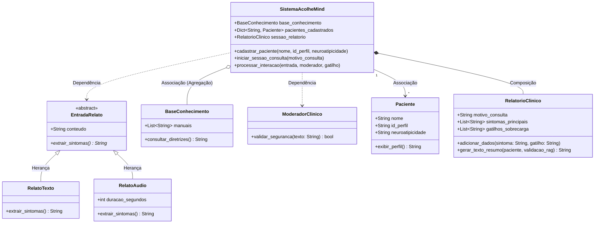

# AcolheMind — Assistente Pré-Consulta (Desk App I)

Software desktop de suporte pré-consulta para pacientes neurodivergentes, desenvolvido em Python (Tkinter) aplicando os conceitos de Programação Orientada a Objetos.

## Diagrama de Classes (UML)

